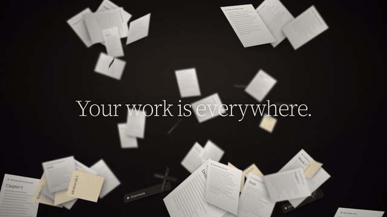
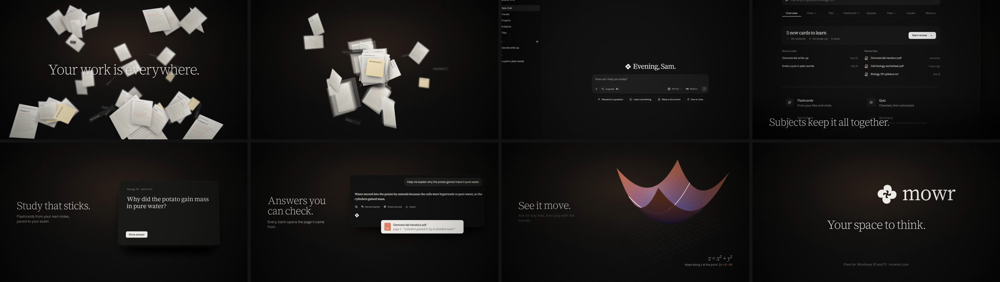
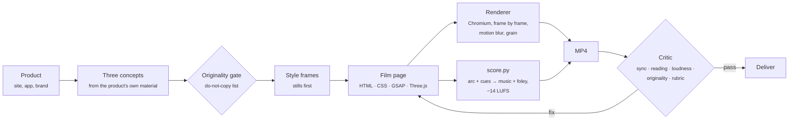

<div align="center">



# Slate

**Original launch films, written as code.**

Claude skills plus a frame-accurate browser film engine. Give Slate a product, and it finds an idea in the product itself, designs style frames, writes the film as a web page, renders it with motion blur and grain, scores it from the edit, and checks it for sync, readability, loudness and originality before you watch it.

[Watch the example film](docs/media/mowr-one-quiet-place.mp4) · [The taste guide](skills/video-taste/SKILL.md) · [The film engine](skills/film-engine/SKILL.md)

</div>

---

## The example: Mowr, "One quiet place"

A 52-second launch film for [Mowr](https://github.com/mowfxy/mowr), a calm, local-first workspace for study and documents. It is set in Mowr's own typefaces, Mowafy Serif and Mowafy Sans, and uses the app's real screens.

<a href="docs/media/mowr-one-quiet-place.mp4"></a>

| | |
|---|---|
| **The idea** | Everything you work on, scattered, settles into one quiet place. It's Mowr's own promise ("one quiet place for the work you bring to an AI") taken literally. |
| **The move** | *The landing.* Things drift, stop, and settle where they belong. It happens at every scale: the pile, files dropping into a subject, a flashcard deck, a report, the folders of a file path. At the end, four sheets land as the four petals of Mowr's mark. |
| **The sound** | Felt piano and a warm pad at 84 BPM. Paper rustles while things drift, the music stops dead when they freeze, and each landing plays the next note of a rising run. A rolled chord rings out on the mark. |
| **Rejected** | A typed prompt that pulls back from a close-up, and a montage of abstract materials, because both are reference moves. Also a feature list over screenshots, because it had no idea. |

Source: [`films/mowr-launch/`](films/mowr-launch). It's one HTML page, one stylesheet and one script, all written for this film.

## How it works



**A film is a web page.** Each film is written new for its idea: CSS 3D, SVG, canvas, WebGL, real web fonts, blend modes and filters, animated on one paused [GSAP](https://gsap.com) timeline. The renderer seeks that timeline to the exact time of every frame and captures it in headless Chromium. It renders four subframes per frame for motion blur and encodes with ffmpeg. Nothing depends on the wall clock, so every frame renders the same way twice.

**There are no templates.** Slate's first version shipped ready-made scenes modeled on its reference films, and every film it made became a remix of them. Slate now gives Claude primitives and principles: camera, depth, landing and type helpers, a taste guide that explains *why* great launch films work, and a list of the references' signature moves that are off-limits.

**One manifest drives picture and sound.** Scenes, the energy arc and every sound cue (a landing, a click, a page flip) are declared in the film. The score is composed from them, so sounds land on the frame.

## The taste

| | |
|---|---|
| **The idea comes from the product** | Take its promise literally, use its own material, or show the tension it resolves. If a competitor's logo would fit at the end, keep looking. |
| **One move, everywhere** | Pick one motion from the idea's verb and use it at every scale: how type enters, how UI arrives, how the logo forms. |
| **Shape** | Breathe, build, peak, land. The biggest moment is often when everything stops. End where you started, changed. |
| **Image** | The real UI, real fonts, light, depth, material, grain, motion blur, and one focal point per frame. |
| **Type** | The brand's typefaces, at most 7 words, sized with restraint, moving with the film's move. |
| **Sound** | The edit is the score. Silence before the moment, a resolve on the mark, −14 LUFS. |

Full guide: [`skills/video-taste`](skills/video-taste/SKILL.md), with [measured benchmarks](skills/video-taste/references/benchmarks.md) and the [do-not-copy list](skills/video-taste/references/do-not-copy.md).

## Quick start

```bash
git clone https://github.com/mowfxy/slate && cd slate
(cd engine && npm install)
python3 -m pip install -r requirements.txt     # numpy, scipy (+ librosa for reference study)

node engine/render.mjs films/mowr-launch --stills 4,9,20   # style frames → films/mowr-launch/build/stills
node engine/render.mjs films/mowr-launch                   # → out/mowr-launch.mp4, score, critic report
node engine/serve.mjs                                      # live preview with a scrubber at localhost:4173/films/mowr-launch/
```

You need Node 20+, Python 3.10+, ffmpeg and a Chromium. Slate finds Playwright's browser cache on its own, or you can set `SLATE_CHROME`.

## Use it with Claude

Slate is a Claude Code plugin:

```
/plugin marketplace add mowfxy/slate
/plugin install slate@slate
```

> Make a 40 second launch film for our new offline mode. 16:9, here's the repo: https://…

The **launch-video** skill directs it. It studies the product, pitches three concepts and rejects any that copy a reference or would fit any brand. Then it builds style frames, writes the film, renders, critiques and fixes until the film passes.

| Skill | What it does |
|---|---|
| [`launch-video`](skills/launch-video/SKILL.md) | The director: product → three concepts → style frames → film → render → critique → deliver |
| [`video-taste`](skills/video-taste/SKILL.md) | Principles for idea, shape, pacing, type, image and sound, plus the do-not-copy list |
| [`film-engine`](skills/film-engine/SKILL.md) | The runtime API, primitives (camera, depth, landing, masks, 3D, WebGL) and render options |
| [`sound-design`](skills/sound-design/SKILL.md) | The generated score (felt, glass, pulse), foley cues, supplied tracks, mastering |
| [`video-critic`](skills/video-critic/SKILL.md) | Automated checks, including originality, plus an 8-line taste rubric |
| [`reference-study`](skills/reference-study/SKILL.md) | Learn principles from videos you like and fingerprint them so renders never copy them |

## A film, briefly

```js
import {film, split} from 'slate';
const F = film({fps: 30, width: 1920, height: 1080, bpm: 84});
const {tl, b} = F;                                    // one paused timeline; b(n) = seconds at beat n

F.scene('quiet', {start: b(15.5), end: b(20.5), kind: 'type', words: 'Give it one quiet place.'}, (tl, el) => {
  const words = split(el.querySelector('h1'), 'words');
  tl.fromTo(words, {y: -34, opacity: 0, filter: 'blur(12px)'},  // words land, like everything else in this film
                   {y: 0, opacity: 1, filter: 'blur(0px)', duration: 1, stagger: 0.1, ease: 'power3.out'});
});
F.cue('drop', b(11.5)).cue('thud', b(12));            // the music stops dead, then the pile begins to settle
F.music({key: 'Eb', style: 'felt', arc: [[0, 0.15], [b(11.4), 0.6], [b(11.5), 0], [b(34), 0.65], [b(70), 0]]});
F.post({grain: 5, vignette: 0.35, blur: 4});
F.end(b(70));
await F.ready();
```

## The critic

Every render ends with a report measured from the file itself, plus a contact sheet for Claude to score:

```
**PASS** · 13 passed, 1 warnings, 0 failed
1920×1080 · 30 fps · 52.50s · 84 BPM

✅  Cuts on the beat              every detected cut within a frame of the ¼-beat grid
✅  Logo holds                    logo on screen 7.86s (≥ 2.5s)
✅  Every line is readable        all words held long enough
✅  Nothing sits frozen           motion everywhere it should be
✅  Loudness on target            -13.8 LUFS integrated (target -14.0), LRA 4.8 LU
✅  Sound resolves at the end     last 0.25s at -42.8 dBFS
✅  Original (not a reference)    0/84 frames close to a reference (0.0%)
⚠️  Planned cuts are visible      1/9: cuts between two dark frames are too soft for the detector
```

The first render of the Mowr film failed: three of the closing lines weren't on screen long enough to read. They got more beats, and the next render passed.

The originality check compares frames against fingerprints of the reference films: layout hashes and color histograms, never the footage itself. On Slate's first launch film, which rebuilt reference shots, it flags 29% of the frames.

## Repo layout

```
engine/      runtime (slate.js), renderer, preview server, tests
films/       one folder per film: index.html, film.css, film.js, assets/
skills/      six Claude skills (the plugin)
tools/       score.py, critic.py, originality.py, analyze_reference.py, beatgrid.py
docs/media/  README media
```

Tests: `node --test engine/test/*.test.mjs` (or `cd engine && npm test`) and `python3 -m unittest tools/test_tools.py`.

## Notes

- Built on [GSAP](https://gsap.com) (free for commercial use), [Three.js](https://threejs.org) (MIT), [Playwright](https://playwright.dev) (Apache 2.0) and ffmpeg. There's no per-seat render license.
- The Mowr film uses Mowr's own screenshots and logo (Mowr is by the same author, [MIT licensed](https://github.com/mowfxy/mowr)), and Mowafy Serif and Sans under the SIL Open Font License ([`films/mowr-launch/assets/fonts/Mowafy-OFL.txt`](films/mowr-launch/assets/fonts/Mowafy-OFL.txt)).
- Use footage, music and logos you have the rights to. The reference films that shaped the taste guide are described and fingerprinted, never included.
- The score is synthesized. A licensed track can replace it with `--music track.wav --offset <downbeat>`.
