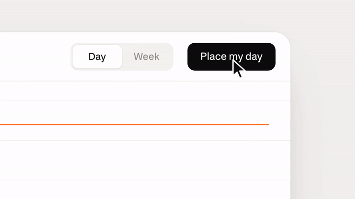
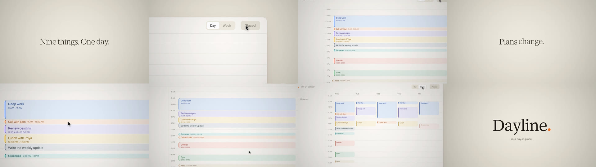
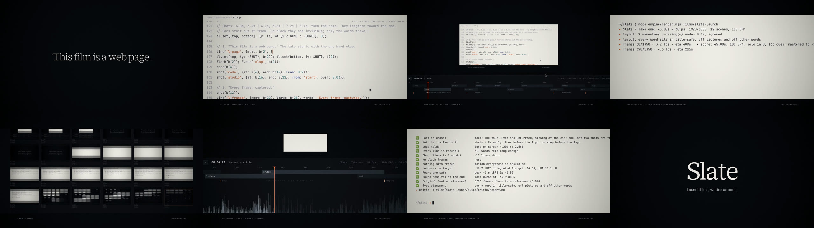
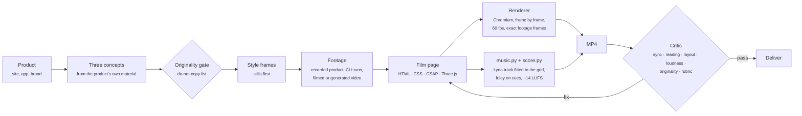

<div align="center">



# Slate

**Original launch films, written as code.**

Claude skills plus a frame-accurate browser film engine. Give Slate a product, and it finds an idea in the product itself, records real footage of the product in use, writes the film as a web page, renders it at 60 fps with a camera that frames what matters, sets it to real music fitted to the cut, and checks timing, type placement, loudness and originality before you watch it.

[Watch the Dayline ad](docs/media/dayline-in-place.mp4) · [Watch the Slate film](docs/media/slate-take-one.mp4) · [The taste guide](skills/video-taste/SKILL.md) · [The film engine](skills/film-engine/SKILL.md)

</div>

---

## The example: Dayline, "In place"

A 27-second ad for Dayline, a day planner that places your list into your day. Dayline was built for this film as a working web app, and every product shot is the real app recorded in use at 60 fps: placing a day, dragging one thing to the afternoon while the rest make room, and opening the week.

<a href="docs/media/dayline-in-place.mp4"></a>

| | |
|---|---|
| **The idea** | Dayline gives each thing its place in the day. So the film is one gesture: something lands in its slot, on the beat. |
| **The move** | *The landing.* Fast in, a long soft stop, on the beat, at every scale: tasks land in the timeline an eighth note apart, words drop into their lines on the cards, the week lands a sixteenth at a time, and the name lands last, then its dot (the one thing with a little weight). |
| **The camera** | Close on the app, so it reads: on *Place my day* as the pointer reaches it, pulling back as the day fills; on the block being dragged, following it down to the afternoon; easing out to the whole week as it fills. The footage is recorded at 2.5× so the close-ups stay sharp. |
| **The form** | *A groove.* One steady pocket at 92 BPM. Cards and shots change on the bar; the cuts are paper to paper, so the film reads as one surface. No build to a drop, no speed-up, no stop. |
| **The sound** | Written as a brief for a real track (Lyria, through [`tools/music.py`](tools/music.py)): a warm, unhurried groove at 92 with Rhodes, a round sub and a relaxed kit, settling under the name. Landings are soft paper taps, not notes. **This render still carries Slate's own sketch score**, which isn't good enough; it will be replaced by a generated track once a Gemini key is set. |
| **Rejected** | Letters typed out on white with one coloured word, a prompt box with a pull-back, app windows in a dark void: all reference moves. The whole app window at 1×, which is unreadable at film size. Bouncy overshoot on every word and a shot that jumps up at each cut. A vibraphone note on every landing, which made the score a toy. |

Source: [`films/dayline-ad/`](films/dayline-ad), with the app in [`app/`](films/dayline-ad/app). The app takes `?bpm=` so its animations land on the film's grid.

## Another example: Slate, "Take one"

A 45-second launch film for Slate, made with Slate. Every shot is real, recorded footage of this film being made: its source typed in an editor, the studio playing it, the render that made it, its frames, its score and the critic's report on it. It's set in Mowafy Serif and Mowafy Sans.

<a href="docs/media/slate-take-one.mp4"></a>

| | |
|---|---|
| **The idea** | A slate is the clapperboard that snaps shut at the start of every take, so picture and sound line up. Slate does that job in code: one timeline drives the picture and the score. So the film is built from the clap. |
| **The move** | *The clap.* Two halves meet on the beat, at every scale. The matte bars close like the sticks. Each line of type arrives as a top half and a bottom half that meet. The name forms the same way. |
| **The form** | *The take.* One unhurried pass. The shots get longer toward the end, not shorter: no montage, no stop before the name. The sticks clap hard once, at the start, like a real slate, then close softly; at the end they close slowly over the last shot, the way a tail slate ends a take. |
| **The footage** | Recorded, not mocked up: the code is typed into a real editor page, the render and critic are real runs played back from their logs, the studio and its waveform are the real preview. All captured with `engine/record.mjs`. |
| **The layout** | One axis. Lines of type sit on the seam in the middle of the frame, on their own black card, never over footage. Labels sit in the bottom bar, in the same slot every time. The layout check passes every word. |
| **The sound** | No music for the first half: one clap, then the footage's own keys and clicks, and the room. Then a sketch solo piano, which is too thin: it is due to be replaced by a generated track, like Dayline's. |
| **Rejected** | A prompt typed into a box while the camera pulls back, a wall of generated films, screens floating in space: all reference moves. A hairline with a serif line above it, too close to a reference's horizon shot. And the film's own first cut: bright plucks building into a half-beat montage, a dead stop, then the name. That is the trailer habit, and it made Slate sound like every launch. |

Source: [`films/slate-launch/`](films/slate-launch). The film is one HTML page, one stylesheet and one script. The footage is recorded by the shot scripts in [`shots/`](films/slate-launch/shots).

## How it works



**A film is a web page.** Each film is written new for its idea: CSS 3D, SVG, canvas, WebGL, real web fonts, blend modes and filters, animated on one paused [GSAP](https://gsap.com) timeline. The renderer seeks that timeline to the exact time of every frame and captures it in headless Chromium. Footage never plays through a `<video>` seek, which in Chromium can paint a stale frame or flash the clip's first frame: the renderer extracts every clip's frames and draws the exact one for each film frame. Films render at 60 fps and encode with ffmpeg. Nothing depends on the wall clock, so every frame renders the same way twice.

**Footage is real.** Product shots are recordings of the product in use, not screenshots sliding around. See [Real footage](#real-footage).

**There are no templates.** Slate's first version shipped ready-made scenes modeled on its reference films, and every film it made became a remix of them. Slate now gives Claude primitives and principles: camera, depth, landing and type helpers, a taste guide that explains *why* great launch films work, and a list of the references' signature moves that are off-limits.

**One manifest drives picture and sound.** Scenes, the energy arc and every sound cue (a landing, a click, a page flip) are declared in the film. The music brief is written from them (a timed outline, tempo, key, length), the track is fitted to the film's beat grid, and the foley lands on the frame.

**Taste in pace and sound, not one formula.** Each film picks a form (the take, call and response, settle, slow reveal, loop, or, rarely, the trailer) and a sound that fits the product. The score is produced the way launch music is: four styles played on sampled instruments (a groove, plucks over a sub, a cinematic section, a bright band) with a real low end, balanced to what the reference films measure, plus quieter sketch styles and no music at all. There are five endings: ring, phrase, button, fade and cut. The critic warns when a film falls into the trailer habit without choosing it. See [Form and sound](#form-and-sound).

## Real footage

A launch film is moving pictures, so Slate records them. A shot script drives a real page in Chromium on a virtual clock and captures every frame, so the clip is smooth at full frame rate on any machine and comes out the same every time:

```js
// films/<name>/shots/compose.mjs  →  node engine/record.mjs films/<name>/shots/compose.mjs
export default {
  url: 'https://app.example.com/new',     // the product itself, or a page on the Slate server
  width: 1920, height: 800, scale: 2.5, fps: 60,  // the picture's aspect, 60 fps, big enough for close-ups
  async run(rec) {
    await rec.cursor(1400, 600);
    await rec.click('#new');              // glides there, clicks for real
    await rec.type('#title', 'Q3 plan');  // a human rhythm, and a key sound per letter in the film
    rec.mark('typed');                    // the film can start the clip from here
    await rec.scroll('#list', 600);
    await rec.hold(1.5);
  },
};
```

| Footage | How |
|---|---|
| A web app in use | `engine/record.mjs` with a shot script: cursor, clicks, typing, scrolling, marks |
| A command-line run | `engine/termcast.mjs` records the real session, the terminal player plays it back |
| Source code | the code player, typing a line back in with live highlighting |
| Filmed or stock video | `engine/footage.mjs prepare clip.mp4` converts it to frame-accurate VP9 |
| Generated atmosphere | `engine/footage.mjs generate "<prompt>"` with Veo, when `GEMINI_API_KEY` is set |

## Layout that holds

Every film declares a grid, and the renderer checks it. Six times a second it finds every visible word and fails the render if a word sits outside title-safe, is cut off by the frame, sits over footage or a picture, collides with other words, or is too small to read. It respects clip paths and anything covering the picture, ignores words in flight for a moment, and accepts deliberate exceptions marked in the page.

```
node engine/render.mjs films/slate-launch --audit
▸ layout: every word sits in title-safe, off pictures and off other words
```

The first full render of this film failed it: the labels in the bottom bar sat just outside title-safe. They moved up into the bar, and every render since has passed.

## The studio

`node engine/serve.mjs`, then open `localhost:4173/films/slate-launch/`. The film plays above its timeline: scenes, every sound cue, and the score's waveform with sound once a render has made it. Drag to scrub, space to play, arrows to step a frame. The studio is in the film: it's the shot after the code.

## The taste

| | |
|---|---|
| **The idea comes from the product** | Take its promise literally, use its own material, or show the tension it resolves. If a competitor's logo would fit at the end, keep looking. |
| **One move, everywhere** | Pick one motion from the idea's verb and use it at every scale: how type enters, how UI arrives, how the logo forms. |
| **Form** | Choose the film's shape from the product: the take, call and response, settle, slow reveal, loop. The trailer (build, faster cuts, a stop, the logo) is one option, for loud launches only. Decide the last second first. |
| **Pacing** | Shots last as long as their content. Most films slow down at the end; a film that speeds up into the logo is a trailer. Leave air. |
| **Layout** | A grid before the first frame: one axis, one slot per kind of words, title-safe margins. Words never sit on busy footage. |
| **Image** | Real moving footage of the real product, real fonts, light, depth, material, grain, motion blur, one focal point per frame. |
| **Type** | The brand's typefaces, at most 7 words, sized with restraint, moving with the film's move. |
| **Sound** | Start from what the product sounds like. Then one ensemble, with a reason. Fewer instruments, more space. The score doesn't have to follow the edit. Choose the ending. −14 LUFS. |

Full guide: [`skills/video-taste`](skills/video-taste/SKILL.md), with [measured benchmarks](skills/video-taste/references/benchmarks.md) and the [do-not-copy list](skills/video-taste/references/do-not-copy.md).

## Form and sound

A launch film doesn't have to build, speed up, go silent and slam the logo. Slate treats that as one form among six, and picks the form, the pace and the sound from the product.

| Form | Pace | Sound | Ends on |
|---|---|---|---|
| The take | Long shots, even, slowing at the end | One instrument, steady | A held frame, a note ringing |
| Call and response | Claim, proof, at an even rhythm | A groove in one gear | The last proof, then the name |
| Settle | Busy, then each shot longer, until still | Thins out to one instrument or the room | Stillness |
| Slow reveal | One image getting clearer, few cuts | A swell with no rhythm | The answer |
| Loop | Even, last frame flows into the first | A repeating figure | The beginning |
| Trailer | Builds, accelerates, stops dead | Builds, silence, a hit | A slam and the logo |

Launch music is produced: recorded instruments, a real low end, mastered loud. Slate can't compose that: it can't hear, and every score it wrote note by note and played on General MIDI samples sounded synthetic next to the references. So the music for a finished film is a real track, either one you supply or one generated by Google's Lyria from a brief Slate writes from the film itself:

```bash
node engine/render.mjs films/dayline-ad --audit           # writes the manifest
python3 tools/music.py prompt films/dayline-ad            # read the brief: notes, tempo, key, a timed outline of the cut
GEMINI_API_KEY=… python3 tools/music.py generate films/dayline-ad --takes 3
# → music/take-1..3.mp3; the first is stretched to the film's tempo, its downbeat put on beat 0,
#   trimmed and faded after the resolve. Then F.music({track: 'music/track.wav'}) and render.
```

Listen to the takes and pick one; `music.py fit` fits any of them, or a track of your own.

The built-in score below is a sketch for drafts and timing checks. The critic warns when a film is about to ship with it. Its four produced styles are played on sampled instruments and balanced to what the reference films measure.

| Score style | Sound | For |
|---|---|---|
| `groove` | Warm pad, electric piano, 808 kick and sub, claps | Everyday apps, ads with a pocket |
| `pluck` | Harp and celesta arpeggios over a sub drone and strings | Teasers, reveals |
| `cinema` | Strings, choir, horns, pulsing celli, deep drums | Brand films, stories |
| `bright` | Strings, piano eighths, bass, a full kit | Optimistic launches |

Quieter synthesized sketch styles are there for films meant to feel small:

| Sketch style | Sound | For |
|---|---|---|
| `solo` | One felt piano, rubato, with rests | Personal, considered, crafted |
| `strings` | A bowed chorale that swells and recedes | Serious, premium, a story |
| `tape` | Swung electric piano, round bass, brushes, on worn tape | Everyday, relaxed |
| `wood` | Marimba ostinato in 3+3+2, a shaker | Playful, handmade |
| `felt`, `glass`, `pulse` | Piano and pad, bell plucks, a driving pulse | Calm, precise, energetic |
| `room` | No music: the product's own sounds | When they are the best score |

Endings are chosen per film: `ring`, `phrase`, `button`, `fade` or `cut`. The full guidance is in [`video-taste`](skills/video-taste/SKILL.md#3-form) and [`sound-design`](skills/sound-design/SKILL.md).

## Quick start

```bash
git clone https://github.com/mowfxy/slate && cd slate
(cd engine && npm install)
python3 -m pip install -r requirements.txt     # numpy, scipy (+ librosa for reference study)
sudo apt install fluidsynth musescore-general-soundfont-lossless   # sampled instruments for the score (macOS: brew install fluid-synth + a GM .sf2, set SLATE_SOUNDFONT)

node engine/record.mjs films/slate-launch/shots/code.mjs     # re-record a shot → films/slate-launch/footage/code.webm
node engine/render.mjs films/slate-launch --stills 2,10,36    # style frames → films/slate-launch/build/stills
node engine/render.mjs films/slate-launch                     # → out/slate-launch.mp4, score, layout check, critic report
node engine/render.mjs films/dayline-ad                       # → out/dayline-ad.mp4
node engine/serve.mjs                                         # the studio at localhost:4173/films/slate-launch/
```

You need Node 20+, Python 3.10+, ffmpeg and a Chromium. Slate finds Playwright's browser cache on its own, or you can set `SLATE_CHROME`.

## Use it with Claude

Slate is a Claude Code plugin:

```
/plugin marketplace add mowfxy/slate
/plugin install slate@slate
```

> Make a 40 second launch film for our new offline mode. 16:9, here's the repo: https://…

The **launch-video** skill directs it. It studies the product, pitches three concepts and rejects any that copy a reference or would fit any brand. Then it builds style frames, writes the film, renders, critiques and fixes until the film passes.

| Skill | What it does |
|---|---|
| [`launch-video`](skills/launch-video/SKILL.md) | The director: product → three concepts → style frames → film → render → critique → deliver |
| [`video-taste`](skills/video-taste/SKILL.md) | Principles for idea, form, pacing, type, image and sound, plus the do-not-copy list |
| [`film-engine`](skills/film-engine/SKILL.md) | The runtime API, primitives (camera, depth, landing, masks, 3D, WebGL) and render options |
| [`sound-design`](skills/sound-design/SKILL.md) | Real music (supplied, or Lyria from the film's brief) fitted to the cut, foley cues, reference band targets, endings, the sketch score, mastering |
| [`video-critic`](skills/video-critic/SKILL.md) | Automated checks, including originality, plus an 8-line taste rubric |
| [`reference-study`](skills/reference-study/SKILL.md) | Learn principles from videos you like and fingerprint them so renders never copy them |

## A film, briefly

```js
import {film} from 'slate';
const F = film({fps: 60, width: 1920, height: 1080, bpm: 100});
const {tl, b} = F;                                   // one paused timeline; b(n) = seconds at beat n

const code = await F.footage('code');                // footage/code.webm + its sidecar: marks, key presses
const v = document.querySelector('[data-scene="code"] video');
v.dataset.at = b(6); v.dataset.from = code.marks.typed - 3;   // which part of the clip plays when
F.scene('code', {start: b(6), end: b(16), kind: 'product'});
F.camera(v, [                                         // close on the line being typed, then out to the file
  {t: b(6), x: 520, y: 300, zoom: 2.2},
  {t: b(12), x: 960, y: 540, zoom: 1.2, ease: 'power3.inOut'},
], {of: code});                                       // x/y in the recorded page's pixels, so clip.rects work
F.cueClip(code, b(6), {from: code.marks.typed - 3});  // the clip's own key presses, on the right frames
F.cue('clap', b(2));                                  // the sticks clap once, to start the take
F.notes({form: 'The take: unhurried, shots lengthen toward the end', sound: 'Felt piano and a low string pad…'});   // the music brief
F.music({key: 'D', track: 'music/track.wav', arc: [[0, 0], [b(40), 0.3], [b(54), 0.55], [b(66), 0.3]]});
F.post({grain: 5, vignette: 0.3});
F.end(b(75));
await F.ready();
```

## The critic

Every render ends with a report measured from the file itself, plus a contact sheet for Claude to score. This is the report on the Dayline ad.

```
**PASS** · 19 passed, 2 warnings, 0 failed
1920×1080 · 60 fps · 26.73s · 92 BPM

✅  Form is chosen                 form: A groove. One steady pocket, cards and shots on the bar…
✅  Not the trailer habit          no stop before the logo
✅  Logo holds                     logo on screen 3.91s (≥ 2.5s)
✅  Every line is readable         all words held long enough
✅  No black frames                none
✅  Nothing sits frozen            motion everywhere it should be
✅  No flashes                     no frame breaks from its neighbours
✅  Smooth motion                  no repeated frames inside motion
✅  Loudness on target             -14.2 LUFS integrated (target -14.0)
✅  Has a low end                  35% below 60 Hz (references: 10–60% sub)
✅  Original (not a reference)     0/53 frames close to a reference (0.0%)
✅  Type placement                 every word in title-safe, off pictures and off other words
⚠️  Real music                     generated sketch score (groove): for delivery use a supplied or Lyria track
⚠️  Planned cuts are visible       0/5: paper-to-paper cuts are too soft for the detector
```

**No flashes** and **Smooth motion** were added after an audit of the earlier renders: they find a frame unlike both its neighbours, and a repeated frame inside motion. On the previous Dayline render they found the footage flashing back to its first frame at 6.70s, where the second of four parallel renderers started with a fresh video seek. The new render also caught, while it was being built, a clip showing in the wrong scene ("Nothing sits frozen") and subframes left blank. Each one is now covered by a test.

The originality check compares frames against fingerprints of the reference films: layout hashes and color histograms, never the footage itself. On Slate's first launch film, which rebuilt reference shots, it flags 29% of the frames.

## Repo layout

```
engine/      runtime (slate.js) and studio, renderer, recorder (record.mjs), termcast, footage tools, players, tests
films/       one folder per film: index.html, film.css, film.js, assets/, shots/ (shot scripts), footage/ (clips)
skills/      six Claude skills (the plugin)
tools/       music.py (Lyria track, fitted to the cut), score.py + arrange.py + sampler.py (foley, sketch score, mastering), critic.py, originality.py, analyze_reference.py, beatgrid.py
docs/media/  README media
```

Tests: `node --test engine/test/*.test.mjs` (or `cd engine && npm test`) and `python3 -m unittest tools/test_tools.py`.

## Notes

- Built on [GSAP](https://gsap.com) (free for commercial use), [Three.js](https://threejs.org) (MIT), [Playwright](https://playwright.dev) (Apache 2.0) and ffmpeg. There's no per-seat render license.
- The example films use Mowafy Serif and Sans under the SIL Open Font License ([`films/slate-launch/assets/fonts/Mowafy-OFL.txt`](films/slate-launch/assets/fonts/Mowafy-OFL.txt)). The studio and the code and terminal players use JetBrains Mono (OFL, [`engine/runtime/fonts`](engine/runtime/fonts)).
- Use footage, music and logos you have the rights to. The reference films that shaped the taste guide are described and fingerprinted, never included.
- Headless Chromium can't decode H.264, so all footage is VP9 WebM. The recorder writes it; `engine/footage.mjs prepare` converts anything else.
- The score is generated from the edit: sampled instruments through FluidSynth (MuseScore General, MIT) when installed, synthesized otherwise. A licensed track can replace it with `--music track.wav --offset <downbeat>`.
