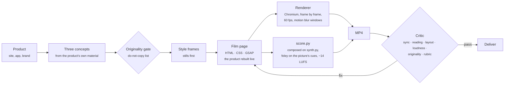

<div align="center">


# Slate

**Launch films, ads and feature announcements, written as code.**

Claude skills plus a frame-accurate film engine. Slate finds the idea in the product, builds the product live inside the film so the camera can go as close as it likes, composes a score for the cut, renders at 60 fps with real motion blur, and checks timing, type, loudness and originality before anyone watches it.

[Watch the Dayline film](docs/media/dayline.mp4) · [The taste guide](skills/video-taste/SKILL.md) · [The film engine](skills/film-engine/SKILL.md) · [Sound](skills/sound-design/SKILL.md)

</div>

---

## The example: Dayline, "Give your list a day"

A 29-second ad for Dayline, a day planner that places your list into your day. One continuous take inside the app, cut twice by a line of type.

<a href="docs/media/dayline.mp4"></a>

| | |
|---|---|
| **The idea** | The dot in Dayline's name is the now-line in the app. So the film follows the dot: it is the full stop of the first line, drops into the app and becomes *now*, and comes back at the end as the dot in the name, riding the now-line in. |
| **The method** | The app is live in the film, not a screen recording. It is real HTML and CSS inside the film page, and the timeline drives it: the press, nine tasks flying into their hours, the drag, the others making room, the week. At 2.4× zoom every edge and letter is still vector-sharp. |
| **The camera** | Starts close on the list, pushes onto *Place my day* as the pointer reaches it, pulls back as the day fills, follows the dragged block down to the afternoon, then eases out to the whole week. Every push and pull is motion-blurred over 8 to 14 subframes. |
| **The motion** | One move at every scale: things land in their hour on the eighth note. Fast out, a long soft stop, no overshoot, no bounce. Words rise into their lines through a mask. |
| **The type** | Mowafy Sans at 172px, tight and left-aligned on hour lines, so the cards read as pages of the same day. One serif moment: the wordmark. Never over the app. |
| **The sound** | A score composed for this cut (120 BPM in D, [`score.py`](films/dayline/score.py)): a pad and a closed pluck under the first line, the pluck opening as the app opens, the groove arriving with the press, a breath for *Plans change.*, the fullest groove for the week, then one low hit under the name with a bell for the dot. Clicks and landings come from the picture's own cues. Mixed by numbers to −14 LUFS. |
| **Rejected** | A screen recording zoomed 2.5× (soft text, and the camera can only crop a flat picture). Warm beige paper with vignette and grain (the app is white; the haze turned it grey). Light 96px serif lines in empty space (too small and quiet to hold a frame). Typed headlines with one coloured word, a prompt-box pull-back, windows floating in space (reference moves). |

Source: [`films/dayline/`](films/dayline), one HTML page, one stylesheet, one script and one score.

## What changed, and why

The previous Dayline cut was rejected. Looking at it frame by frame, the problems were craft, not the engine:

| Before | Now |
|---|---|
| Screen recordings blown up 2.5×: soft text, compression, a flat picture the camera could only crop | **The product is live in the film.** Rebuilt as DOM, driven by the timeline, sharp at any zoom, and every element can be animated on its own |
| Small light serif lines floating in the middle of empty paper | **Type is big and tight**: 140–180px, set on a grid that belongs to the product (here, the day's hour lines) |
| Beige paper, vignette and grain over a white app | Full contrast, no haze over product UI |
| Cuts between separate clips | **One take** through the app, with the camera doing the editing |
| Sketch score on General MIDI samples | **A composed electronic score** on [`tools/synth.py`](tools/synth.py): band-limited saws, a resonant filter, FM bells, 808 drums, a convolution hall, ping-pong delay, sidechain, glue compression and a lookahead limiter, mixed to target levels per instrument |
| No motion blur; fast camera moves strobed | **Motion blur where things move** (`F.blur(from, to, samples)`), off where they don't, so the render stays fast |
| Labels in the app cut off by the edge of the frame | The layout check now finds **UI text cut by the frame** and fails the render |

## How it works



**A film is a web page.** Each film is written new for its idea, animated on one paused [GSAP](https://gsap.com) timeline. The renderer seeks that timeline to the exact time of every frame in headless Chromium and encodes with ffmpeg. Nothing depends on the wall clock, so every frame renders the same way twice.

**The product is in the film.** For an app or a site, Slate rebuilds the screens that matter as DOM inside the film (`[data-ui]`) and drives their state from the timeline with `F.onFrame(t)`. `F.camera` moves over it in the app's own pixels and can project any point to the screen, so a dot can fly from a line of type to the exact pixel of the app's now-line. Screen recording (`engine/record.mjs`) is still there for things that can't be rebuilt.

**Motion blur is declared.** `F.blur(from, to, samples)` marks the windows where the camera or objects move fast. The renderer captures that many subframes per frame there and averages them, and renders everything else once. Dayline is blurred on 636 of its 1,740 frames.

**One manifest drives picture and sound.** Scenes, beats and every cue (a click, a landing, a drop) are declared in the film. The film's own `score.py` reads that manifest and composes to it, so the foley lands on the frame and the music changes where the picture does.

**There are no templates.** Slate gives Claude primitives and principles: camera, masks, landing and type helpers, a taste guide that explains *why* great launch films work, and a list of the reference films' signature moves that are off-limits.

## The sound

Slate composes each film's score in Python on [`tools/synth.py`](tools/synth.py), written for the cut: tempo and key from the film, sections from its scenes, foley from its cues.

```python
s = Song(bpm=120, beats=58)
s.bus('pluck', verb=0.3, delay=0.28, duck=0.3, hp=180)       # buses with reverb, delay, sidechain
s.pad([57, 61, 64, 66, 69], at=0, beats=4, cutoff=900, open_to=1500)
s.pluck(74, at=8.5, cutoff=800, env_amt=2200)                # a filtered saw pluck that opens with the app
s.kick(at=16); s.sub(38, at=16, beats=1)                     # the groove arrives with the press
s.impact(at=48); s.bell(81, at=49.5)                         # one low hit under the name, a bell for the dot
s.master('mix.wav', lufs=-14, levels={'kick': -15, 'pad': -23, 'pluck': -19, 'hat': -30})
```

`levels` sets each instrument's loudness while it plays, so the balance is decided by numbers, not by ear. `--stems` writes every bus to its own file.

You can also use a track you supply (`--music track.wav --offset <downbeat>`), or a generated one from Google's Lyria through [`tools/music.py`](tools/music.py), which writes the brief from the film and fits the take to its beat grid. Lyria needs `GEMINI_API_KEY`, which isn't set in this setup yet.

## Layout that holds

Every film declares a grid, and the renderer checks it six times a second. It fails the render if a word sits outside title-safe, collides with other words, sits over a picture, is too small to read, or (new) if a label inside the product is cut by the edge of the frame. It respects masks, clip paths and anything covering the text.

```
node engine/render.mjs films/dayline --audit
▸ layout: every word sits in title-safe, off pictures and off other words
```

## The critic

Every render ends with a report measured from the file itself, plus a contact sheet for Claude to score. This is the report on the Dayline film:

```
PASS · 19 passed, 1 warning, 0 failed
1920×1080 · 60 fps · 29.00s · 120 BPM · 2 cuts · median shot 12.00s

✅  Cuts on the beat               2/2 detected cuts within a frame of the ¼-beat grid
✅  Form is chosen                 One continuous take inside the app, cut by two lines of type on downbeats
✅  Real music                     composed for this cut (films/dayline/score.py)
✅  Not the trailer habit          no stop before the logo
✅  Logo holds                     logo on screen 5.00s
✅  Every line is readable         all words held long enough
✅  No flashes / Smooth motion     no frame breaks from its neighbours; no repeated frames inside motion
✅  Loudness on target             -14.1 LUFS integrated, LRA 3.5 LU, peak -0.5 dBFS
✅  Original (not a reference)     0/37 frames close to a reference; 5 more reviewed as coincidence
✅  Type placement                 every word in title-safe, off pictures and off other words
⚠️  Planned cuts are visible       2/3: the push into the app is a cut by design, not by the detector
```

The originality check compares frames to fingerprints of the reference films (layout hashes and colour histograms, never the footage). Five frames of Dayline (an orange dot on an empty white page at the start, and the first second of the wordmark) sat close to one reference's white frames. They were looked at and waived with a written reason in the film's `notes.reviewed`, which the report prints.

## Quick start

```bash
git clone https://github.com/mowfxy/slate && cd slate
(cd engine && npm install)
python3 -m pip install -r requirements.txt

node engine/render.mjs films/dayline --stills 2,8,20    # style frames → films/dayline/build/stills
node engine/render.mjs films/dayline                    # → out/dayline.mp4, score, layout check, critic report
node engine/serve.mjs                                   # the studio at localhost:4173/films/dayline/
```

You need Node 20+, Python 3.10+, ffmpeg and a Chromium. Slate finds Playwright's browser cache on its own, or set `SLATE_CHROME`. The full Dayline render takes about six minutes on 4 cores, most of it in the motion-blurred frames.

## Use it with Claude

Slate is a Claude Code plugin:

```
/plugin marketplace add mowfxy/slate
/plugin install slate@slate
```

> Make a 30 second ad for our new offline mode. 16:9, here's the repo: https://…

The **launch-video** skill directs it. It studies the product, pitches three concepts and rejects any that copy a reference or would fit any brand, builds style frames, rebuilds the product live in the film, composes the score, renders, critiques and fixes until the film passes.

| Skill | What it does |
|---|---|
| [`launch-video`](skills/launch-video/SKILL.md) | The director: product → three concepts → style frames → film → score → render → critique → deliver |
| [`video-taste`](skills/video-taste/SKILL.md) | Principles for idea, form, pacing, type, image and sound, plus the do-not-copy list |
| [`film-engine`](skills/film-engine/SKILL.md) | The runtime API: live product, camera, blur, masks, landing, 3D, and render options |
| [`sound-design`](skills/sound-design/SKILL.md) | Composing on synth.py, mixing by numbers, foley cues, supplied or Lyria tracks, endings, mastering |
| [`video-critic`](skills/video-critic/SKILL.md) | Automated checks, including originality, plus an 8-line taste rubric |
| [`reference-study`](skills/reference-study/SKILL.md) | Learn principles from videos you like and fingerprint them so renders never copy them |

## A film, briefly

```js
import {film} from 'slate';
const F = film({fps: 60, width: 1920, height: 1080, bpm: 120});
const {tl, b} = F;                                     // one paused timeline; b(n) = seconds at beat n

const cam = F.camera('#world', [                       // the camera over the live app, in the app's pixels
  {t: b(8),  x: 720, y: 452, zoom: 1.2},
  {t: b(14), x: 1560, y: 90, zoom: 2.9, ease: 'power3.inOut'},   // onto the button as the pointer reaches it
  {t: b(18), x: 860, y: 490, zoom: 1.1, ease: 'power3.inOut'},   // pull back as the day fills
]);
tl.to('#go', {scale: 0.95, duration: 0.08}, b(14) - 0.06);       // the press
TASKS.forEach((t, i) => tl.fromTo(blocks[i], {left: 28}, {left: 556, top: hourY(t.at), duration: 0.8, ease: 'power3.inOut'}, b(16) + i * 0.25));
F.onFrame(t => { $('#goLabel').textContent = t < b(14) ? 'Place my day' : 'Placing…'; });  // state as a pure function of time
const now = cam.project(b(7.5), NOW.x, NOW.y);         // where the app's now-dot is on screen at that moment
F.blur(b(13.4), b(18.4), 14);                          // motion blur on the push and the pull
F.cue('click', b(14));                                 // foley the score picks up
F.music({key: 'D', composed: 'films/dayline/score.py'});
F.end(b(58));
await F.ready();
```

## Repo layout

```
engine/      runtime (slate.js) and studio, renderer, recorder, termcast, footage tools, players, tests
films/       one folder per film: index.html, film.css, film.js, score.py, assets/
skills/      six Claude skills (the plugin)
tools/       synth.py (the instruments and the mix), critic.py, originality.py, music.py (Lyria, or your own track),
             score.py + arrange.py + sampler.py (foley and the older sketch scores), analyze_reference.py, beatgrid.py
docs/media/  README media
```

Tests: `node --test engine/test/*.test.mjs` and `python3 -m unittest tools/test_tools.py`.

## Notes

- Built on [GSAP](https://gsap.com) (free for commercial use), [Playwright](https://playwright.dev) (Apache 2.0), [Three.js](https://threejs.org) (MIT) and ffmpeg. The score uses numpy, scipy, numba and pyloudnorm. There's no per-seat render license.
- The example film uses Mowafy Serif and Sans under the SIL Open Font License ([`films/dayline/assets/fonts/Mowafy-OFL.txt`](films/dayline/assets/fonts/Mowafy-OFL.txt)).
- Dayline is a product made up for this example. Use footage, music and logos you have the rights to. The reference films that shaped the taste guide are described and fingerprinted, never included.
