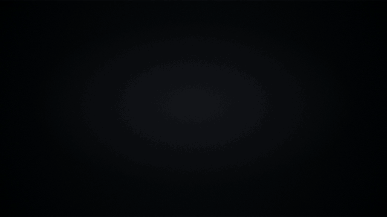
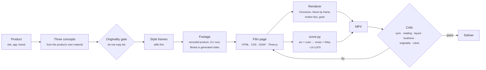

<div align="center">



# Slate

**Original launch films, written as code.**

Claude skills plus a frame-accurate browser film engine. Give Slate a product, and it finds an idea in the product itself, records real footage of the product in use, writes the film as a web page, renders it with motion blur and grain, scores it from the edit, and checks timing, type placement, loudness and originality before you watch it.

[Watch the example film](docs/media/slate-take-one.mp4) · [The taste guide](skills/video-taste/SKILL.md) · [The film engine](skills/film-engine/SKILL.md)

</div>

---

## The example: Slate, "Take one"

A 40-second launch film for Slate, made with Slate. Every shot is real, recorded footage of this film being made: its source typed in an editor, the studio playing it, the render that made it, its frames, its score and the critic's report on it. It's set in Mowafy Serif and Mowafy Sans.

<a href="docs/media/slate-take-one.mp4"></a>

| | |
|---|---|
| **The idea** | A slate is the clapperboard that snaps shut at the start of every take, so picture and sound line up. Slate does that job in code: one timeline drives the picture and the score. So the film is built from the clap. |
| **The move** | *The clap.* Two halves meet on the beat, at every scale. The matte bars close like the sticks. Each line of type arrives as a top half and a bottom half that snap together. The name lands the same way after a beat of silence. |
| **The footage** | Recorded, not mocked up: the code is typed into a real editor page, the render and critic are real runs played back from their logs, the studio and its waveform are the real preview. All captured with `engine/record.mjs`. |
| **The layout** | One axis. Lines of type sit on the seam in the middle of the frame, on their own black card, never over footage. Labels sit in the bottom bar, in the same slot every time. The layout check passes every word. |
| **The sound** | Glass plucks over a pad at 100 BPM. A wooden clap on every close, the footage's own key presses, the music cut dead before the name, and a chord that rings out under it. |
| **Rejected** | A prompt typed into a box while the camera pulls back, a wall of generated films, screens floating in space: all reference moves. Also a hairline with a serif line above it, which is too close to a reference's horizon shot. |

Source: [`films/slate-launch/`](films/slate-launch). The film is one HTML page, one stylesheet and one script. The footage is recorded by the shot scripts in [`shots/`](films/slate-launch/shots).

## How it works



**A film is a web page.** Each film is written new for its idea: CSS 3D, SVG, canvas, WebGL, real web fonts, blend modes and filters, animated on one paused [GSAP](https://gsap.com) timeline. The renderer seeks that timeline to the exact time of every frame and captures it in headless Chromium. It renders four subframes per frame for motion blur and encodes with ffmpeg. Nothing depends on the wall clock, so every frame renders the same way twice.

**Footage is real.** Product shots are recordings of the product in use, not screenshots sliding around. See [Real footage](#real-footage).

**There are no templates.** Slate's first version shipped ready-made scenes modeled on its reference films, and every film it made became a remix of them. Slate now gives Claude primitives and principles: camera, depth, landing and type helpers, a taste guide that explains *why* great launch films work, and a list of the references' signature moves that are off-limits.

**One manifest drives picture and sound.** Scenes, the energy arc and every sound cue (a landing, a click, a page flip) are declared in the film. The score is composed from them, so sounds land on the frame.

## Real footage

A launch film is moving pictures, so Slate records them. A shot script drives a real page in Chromium on a virtual clock and captures every frame, so the clip is smooth at full frame rate on any machine and comes out the same every time:

```js
// films/<name>/shots/compose.mjs  →  node engine/record.mjs films/<name>/shots/compose.mjs
export default {
  url: 'https://app.example.com/new',     // the product itself, or a page on the Slate server
  width: 1920, height: 800, scale: 1.25,  // the picture's aspect, recorded big enough to push in
  async run(rec) {
    await rec.cursor(1400, 600);
    await rec.click('#new');              // glides there, clicks for real
    await rec.type('#title', 'Q3 plan');  // a human rhythm, and a key sound per letter in the film
    rec.mark('typed');                    // the film can start the clip from here
    await rec.scroll('#list', 600);
    await rec.hold(1.5);
  },
};
```

| Footage | How |
|---|---|
| A web app in use | `engine/record.mjs` with a shot script: cursor, clicks, typing, scrolling, marks |
| A command-line run | `engine/termcast.mjs` records the real session, the terminal player plays it back |
| Source code | the code player, typing a line back in with live highlighting |
| Filmed or stock video | `engine/footage.mjs prepare clip.mp4` converts it to frame-accurate VP9 |
| Generated atmosphere | `engine/footage.mjs generate "<prompt>"` with Veo, when `GEMINI_API_KEY` is set |

## Layout that holds

Every film declares a grid, and the renderer checks it. Six times a second it finds every visible word and fails the render if a word sits outside title-safe, is cut off by the frame, sits over footage or a picture, collides with other words, or is too small to read. It respects clip paths and anything covering the picture, ignores words in flight for a moment, and accepts deliberate exceptions marked in the page.

```
node engine/render.mjs films/slate-launch --audit
▸ layout: every word sits in title-safe, off pictures and off other words
```

The first full render of this film failed it: the labels in the bottom bar sat just outside title-safe. They moved up into the bar, and every render since has passed.

## The studio

`node engine/serve.mjs`, then open `localhost:4173/films/slate-launch/`. The film plays above its timeline: scenes, every sound cue, and the score's waveform with sound once a render has made it. Drag to scrub, space to play, arrows to step a frame. The studio is in the film: it's the shot after the code.

## The taste

| | |
|---|---|
| **The idea comes from the product** | Take its promise literally, use its own material, or show the tension it resolves. If a competitor's logo would fit at the end, keep looking. |
| **One move, everywhere** | Pick one motion from the idea's verb and use it at every scale: how type enters, how UI arrives, how the logo forms. |
| **Shape** | Breathe, build, peak, land. The biggest moment is often when everything stops. End where you started, changed. |
| **Layout** | A grid before the first frame: one axis, one slot per kind of words, title-safe margins. Words never sit on busy footage. |
| **Image** | Real moving footage of the real product, real fonts, light, depth, material, grain, motion blur, one focal point per frame. |
| **Type** | The brand's typefaces, at most 7 words, sized with restraint, moving with the film's move. |
| **Sound** | The edit is the score. Silence before the moment, a resolve on the mark, −14 LUFS. |

Full guide: [`skills/video-taste`](skills/video-taste/SKILL.md), with [measured benchmarks](skills/video-taste/references/benchmarks.md) and the [do-not-copy list](skills/video-taste/references/do-not-copy.md).

## Quick start

```bash
git clone https://github.com/mowfxy/slate && cd slate
(cd engine && npm install)
python3 -m pip install -r requirements.txt     # numpy, scipy (+ librosa for reference study)

node engine/record.mjs films/slate-launch/shots/code.mjs     # re-record a shot → films/slate-launch/footage/code.webm
node engine/render.mjs films/slate-launch --stills 2,10,36    # style frames → films/slate-launch/build/stills
node engine/render.mjs films/slate-launch                     # → out/slate-launch.mp4, score, layout check, critic report
node engine/serve.mjs                                         # the studio at localhost:4173/films/slate-launch/
```

You need Node 20+, Python 3.10+, ffmpeg and a Chromium. Slate finds Playwright's browser cache on its own, or you can set `SLATE_CHROME`.

## Use it with Claude

Slate is a Claude Code plugin:

```
/plugin marketplace add mowfxy/slate
/plugin install slate@slate
```

> Make a 40 second launch film for our new offline mode. 16:9, here's the repo: https://…

The **launch-video** skill directs it. It studies the product, pitches three concepts and rejects any that copy a reference or would fit any brand. Then it builds style frames, writes the film, renders, critiques and fixes until the film passes.

| Skill | What it does |
|---|---|
| [`launch-video`](skills/launch-video/SKILL.md) | The director: product → three concepts → style frames → film → render → critique → deliver |
| [`video-taste`](skills/video-taste/SKILL.md) | Principles for idea, shape, pacing, type, image and sound, plus the do-not-copy list |
| [`film-engine`](skills/film-engine/SKILL.md) | The runtime API, primitives (camera, depth, landing, masks, 3D, WebGL) and render options |
| [`sound-design`](skills/sound-design/SKILL.md) | The generated score (felt, glass, pulse), foley cues, supplied tracks, mastering |
| [`video-critic`](skills/video-critic/SKILL.md) | Automated checks, including originality, plus an 8-line taste rubric |
| [`reference-study`](skills/reference-study/SKILL.md) | Learn principles from videos you like and fingerprint them so renders never copy them |

## A film, briefly

```js
import {film} from 'slate';
const F = film({fps: 30, width: 1920, height: 1080, bpm: 100});
const {tl, b} = F;                                   // one paused timeline; b(n) = seconds at beat n

const code = await F.footage('code');                // footage/code.webm + its sidecar: marks, key presses
const v = document.querySelector('[data-scene="code"] video');
v.dataset.at = b(6); v.dataset.from = code.marks.typed - 3;   // which part of the clip plays when
F.scene('code', {start: b(6), end: b(14), kind: 'product'}, (sub) => {
  sub.fromTo(v, {scale: 1}, {scale: 1.04, duration: b(8), ease: 'none'});   // a slow push
});
F.cueClip(code, b(6), {from: code.marks.typed - 3});  // the clip's own key presses, on the right frames
F.cue('clap', b(18));                                 // the bars snap shut on the beat
F.music({key: 'D', style: 'glass', arc: [[0, 0], [b(2), 0.25], [b(51), 0.9], [b(59), 0.2]]});
F.post({grain: 5, vignette: 0.3, blur: 4});
F.end(b(67));
await F.ready();
```

## The critic

Every render ends with a report measured from the file itself, plus a contact sheet for Claude to score. This is the report on the example film. Its last shot shows the same check running on the render before this one.

```
**PASS** · 14 passed, 1 warnings, 0 failed
1920×1080 · 30 fps · 40.20s · 100 BPM

✅  Cuts on the beat               12/12 detected cuts within a frame of the ¼-beat grid (100%)
✅  Logo holds                     logo on screen 3.60s (≥ 2.5s)
✅  Every line is readable         all words held long enough
✅  No black frames                none
✅  Nothing sits frozen            motion everywhere it should be
✅  Loudness on target             -13.9 LUFS integrated (target -14.0), LRA 6.4 LU
✅  Peaks are safe                 peak -1.3 dBFS (≤ −0.5)
✅  Original (not a reference)     0/45 frames close to a reference (0.0%)
✅  Type placement                 every word in title-safe, off pictures and off other words
⚠️  Planned cuts are visible       2/7: cuts between two dark frames are too soft for the detector
```

The originality check compares frames against fingerprints of the reference films: layout hashes and color histograms, never the footage itself. On Slate's first launch film, which rebuilt reference shots, it flags 29% of the frames.

## Repo layout

```
engine/      runtime (slate.js) and studio, renderer, recorder (record.mjs), termcast, footage tools, players, tests
films/       one folder per film: index.html, film.css, film.js, assets/, shots/ (shot scripts), footage/ (clips)
skills/      six Claude skills (the plugin)
tools/       score.py, critic.py, originality.py, analyze_reference.py, beatgrid.py
docs/media/  README media
```

Tests: `node --test engine/test/*.test.mjs` (or `cd engine && npm test`) and `python3 -m unittest tools/test_tools.py`.

## Notes

- Built on [GSAP](https://gsap.com) (free for commercial use), [Three.js](https://threejs.org) (MIT), [Playwright](https://playwright.dev) (Apache 2.0) and ffmpeg. There's no per-seat render license.
- The example film uses Mowafy Serif and Sans under the SIL Open Font License ([`films/slate-launch/assets/fonts/Mowafy-OFL.txt`](films/slate-launch/assets/fonts/Mowafy-OFL.txt)). The studio and the code and terminal players use JetBrains Mono (OFL, [`engine/runtime/fonts`](engine/runtime/fonts)).
- Use footage, music and logos you have the rights to. The reference films that shaped the taste guide are described and fingerprinted, never included.
- Headless Chromium can't decode H.264, so all footage is VP9 WebM. The recorder writes it; `engine/footage.mjs prepare` converts anything else.
- The score is synthesized. A licensed track can replace it with `--music track.wav --offset <downbeat>`.
