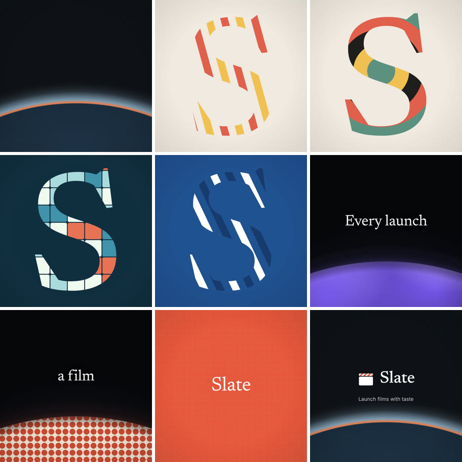
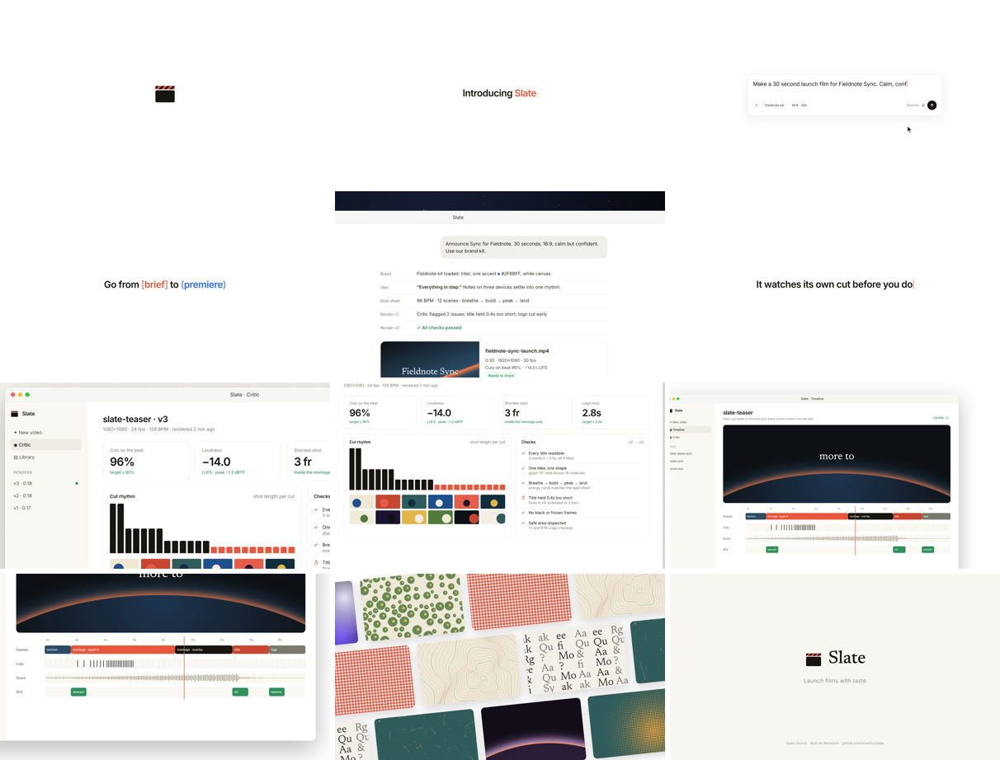
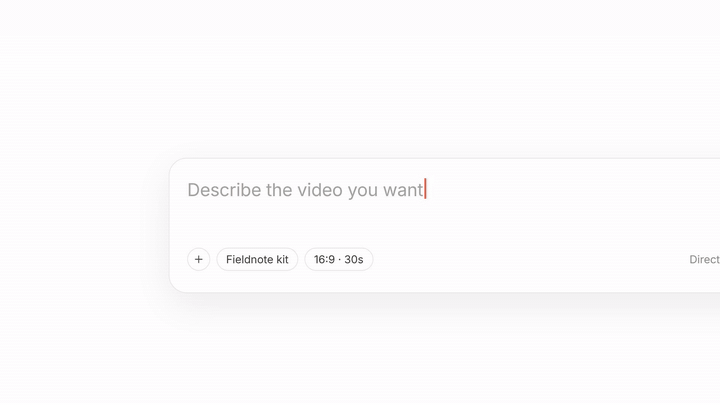
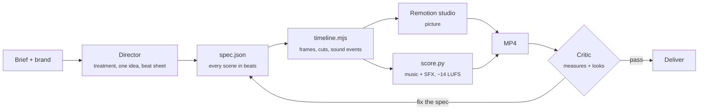

<div align="center">


# Slate

**Launch films with taste, written as code.**

Claude skills plus a Remotion studio that turn a product brief into a launch video, feature announcement, teaser or ad,<br>with a score composed from the edit and a critic that watches every cut before you do.

[Watch the teaser](docs/media/slate-teaser.mp4) · [Watch the launch film](docs/media/slate-launch.mp4) · [The taste guide](skills/video-taste/SKILL.md) · [Spec reference](docs/spec.md)

</div>

---

## What it makes

Both films below were written as a JSON spec, rendered, scored and critiqued by Slate itself. Everything you see and hear is generated: no stock footage, no stock music.

<table>
<tr>
<td width="50%" valign="top">

**Brand teaser** · 1:1 · 18.8s · 128 BPM<br>
<sub>One idea (the S is made of everything), 3-frame cuts locked to the beat, a planet-edge montage with one line of type, a title hit, and a logo that bookends the opening horizon.</sub>

<a href="docs/media/slate-teaser.mp4"></a>

[`examples/slate-teaser/spec.json`](examples/slate-teaser/spec.json)

</td>
<td width="50%" valign="top">

**Product launch** · 16:9 · 61s · 96 BPM<br>
<sub>Typed headlines, a prompt box that pulls back as it types, kinetic brackets, camera moves through real UI captures on a space backdrop, a wall of outputs, and a held logo.</sub>

<a href="docs/media/slate-launch.mp4"></a>

[`examples/slate-launch/spec.json`](examples/slate-launch/spec.json)

</td>
</tr>
</table>

<div align="center">

</div>

## How it works



One timeline drives both picture and sound, so they cannot drift: cuts land on the beat grid, every typed letter gets a key tap, every click gets a click, the riser builds into the title and the last chord rings out on the logo.

## The taste

The rules come from frame-by-frame study of five top-tier launch films (cut detection, loudness, tempo, onset sync, contact sheets). The short version:

| | |
|---|---|
| **One idea** | Say it in five words before writing anything. Every shot serves it. |
| **Shape** | Breathe → build → peak → land. The last quarter is the calmest. Bookend the opening frame. |
| **Pace in beats** | Scenes are whole beats; montage shots are 1 → ¼ beat, accelerating. Fast cuts need a repeated shape. |
| **Type** | Two voices max. ≤ 7 words, centered, one accented word. Restraint reads as confidence. |
| **Camera, not transitions** | Push in on the one control that matters, then pull back to reveal. Match cuts over wipes. |
| **Sound** | The edit is the score. Drop before the hit, resolve on the logo, master to −14 LUFS. |

Full guide: [`skills/video-taste`](skills/video-taste/SKILL.md), with [archetype recipes](skills/video-taste/references/archetypes.md) and [measured benchmarks](skills/video-taste/references/benchmarks.md).

## Quick start

```bash
git clone https://github.com/mowfxy/slate && cd slate
cd studio && npm install && cd ..
python3 -m pip install -r requirements.txt     # numpy, scipy (+ librosa for reference study)

cd studio
node scripts/render.mjs ../examples/slate-teaser
# ▸ Slate · teaser: 18.75s, 450 frames @ 24fps, 5 scenes, 128 BPM
# ▸ score: … mastered to -14.0 LUFS
# ▸ video -> ../out/slate-teaser.mp4
# **PASS** · 13 passed, 0 warnings, 0 failed
```

Needs Node 20+, Python 3.10+ and ffmpeg. Remotion downloads its own headless Chrome, or set `SLATE_CHROME` to an existing Chromium.

## Use it with Claude

Slate is a Claude Code plugin. Add it, then ask for a video:

```
/plugin marketplace add mowfxy/slate
/plugin install slate@slate
```

> Make a 30 second launch film for our new Sync feature. 16:9, calm but confident, here's our site: https://…

The **launch-video** skill runs the whole loop: read the product, write a treatment with one idea and a beat sheet, capture the UI, write the spec, check stills, render, critique, fix, deliver. Working inside this repo, the skills load from `.claude/skills` automatically.

| Skill | What it does |
|---|---|
| [`launch-video`](skills/launch-video/SKILL.md) | The director: brief → treatment → spec → render → critique → deliver |
| [`video-taste`](skills/video-taste/SKILL.md) | Structure, pacing, type, motion, color and sound rules, adapted per product |
| [`remotion-kit`](skills/remotion-kit/SKILL.md) | The scene types and how to extend the studio safely |
| [`sound-design`](skills/sound-design/SKILL.md) | Generated score, supplied tracks on the beat grid, SFX, mastering |
| [`video-critic`](skills/video-critic/SKILL.md) | Automated checks plus a 7-line taste rubric for the contact sheet |
| [`reference-study`](skills/reference-study/SKILL.md) | Learn a new style from videos you like |

## A spec, briefly

```jsonc
{
  "meta": {"title": "Fieldnote · Sync", "archetype": "demo", "width": 1920, "height": 1080, "fps": 30, "bpm": 96},
  "brand": {"name": "Fieldnote", "accent": "#2f6bff", "ink": "#111111", "paper": "#faf8f3", "wordmark": "sans", "mark": "none"},
  "scenes": [
    {"type": "typeTitle", "beats": 5, "text": "Introducing *Sync*"},
    {"type": "promptBox", "beats": 8, "prompt": "Keep my notes in step on every device", "chips": ["Fieldnote"]},
    {"type": "bracketTitle", "beats": 6, "text": "From [draft] to (everywhere)"},
    {"type": "uiShot", "beats": 10, "image": "assets/app.png", "backdrop": "space",
     "camera": [{"t": 0, "zoom": 1}, {"t": 0.6, "zoom": 1}, {"t": 1.6, "x": 0.3, "y": 0.25, "zoom": 2}],
     "cursor": [{"t": 3.5, "x": 0.8, "y": 0.6, "click": true}]},
    {"type": "logoEnd", "beats": 8, "tagline": "Everything in step", "footnote": "Available today"}
  ]
}
```

Nine scene types (`logo`, `typeTitle`, `bracketTitle`, `promptBox`, `uiShot`, `montage`, `cardGrid`, `titleCard`, `logoEnd`), fifteen procedural materials, glyph / lens / horizon masks, camera and cursor keyframes. Full reference: [`docs/spec.md`](docs/spec.md).

## The critic

Every render ends with a report measured from the file itself, plus a contact sheet for Claude to look at:

```
**PASS** · 13 passed, 0 warnings, 0 failed
1080×1080 · 24 fps · 18.75s · 128 BPM · 49 cuts · median shot 0.21s

✅  Cuts on the beat           49/49 detected cuts within a frame of the ¼-beat grid (100%)
✅  The ending lands           0 cuts in the final 15%; cuts per quarter [7, 23, 18, 1]
✅  Logo holds                 logo on screen 3.28s (≥ 2.5s)
✅  Every title is readable    all titles held long enough
✅  Loudness on target         -14.0 LUFS integrated (target -14.0), LRA 5.1 LU
✅  Sound resolves at the end  last 0.25s at -50.6 dBFS
```

The first launch-film render failed on five titles that were not held long enough to read; the spec was fixed and re-rendered until it passed. That loop is the point. The critic's numbers are a floor: Claude still scores the contact sheet against the taste rubric before delivering.

## Repo layout

```
skills/            six Claude skills (the plugin)
studio/            Remotion project: components, timeline, render + capture scripts, tests
tools/             score.py, critic.py, analyze_reference.py, beatgrid.py (Python)
examples/          slate-launch (demo) and slate-teaser (teaser): spec, UI mocks, captures
docs/              spec reference and README media
```

Tests: `cd studio && npm test && npm run typecheck`, and `python3 -m unittest tools/test_tools.py`.

## Notes

- Slate renders with [Remotion](https://www.remotion.dev). Remotion is free for individuals and companies of up to three people; larger companies need a [company license](https://www.remotion.dev/license).
- Use footage, music and logos you have rights to. The reference films that shaped the taste guide are described in the benchmarks, not included.
